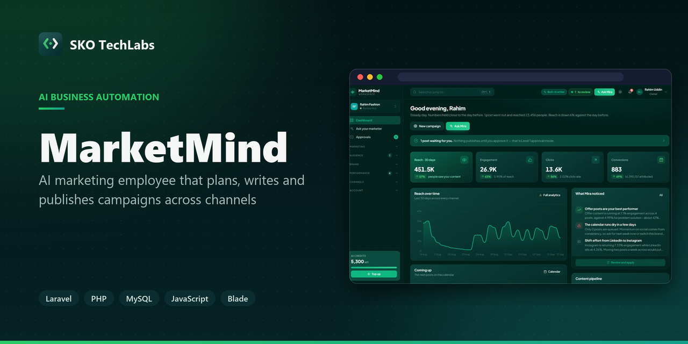
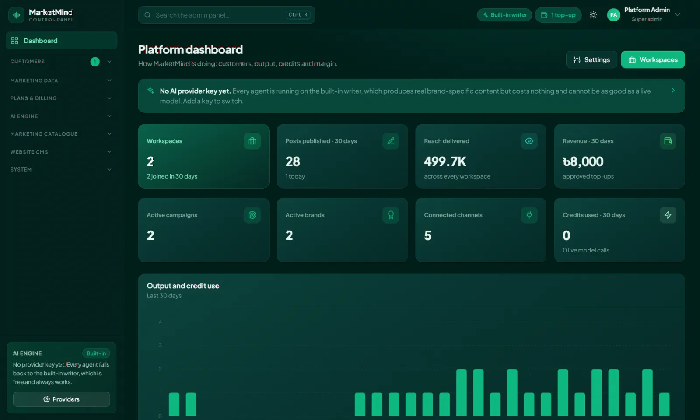
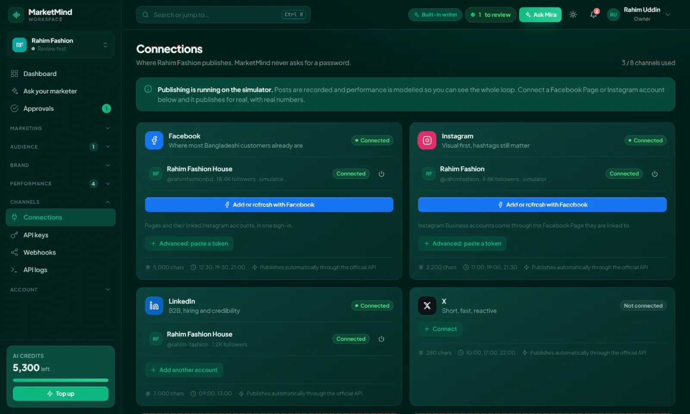
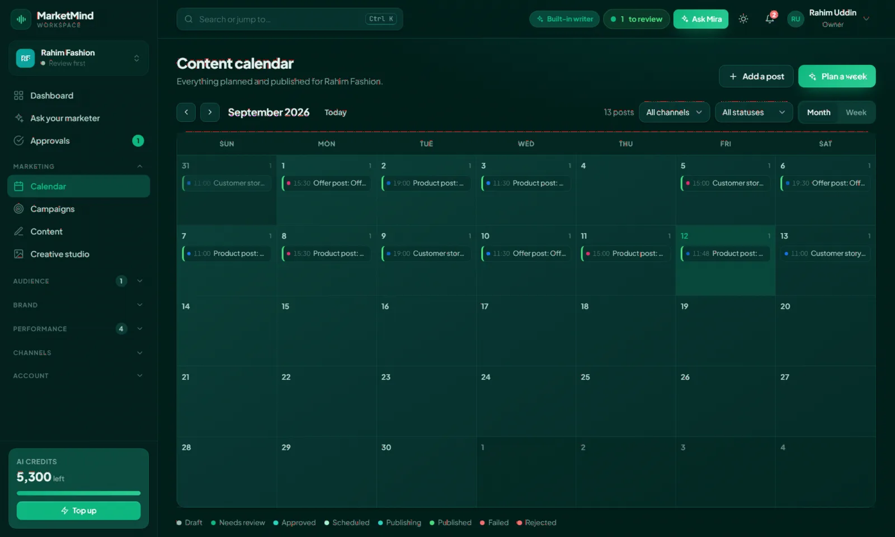
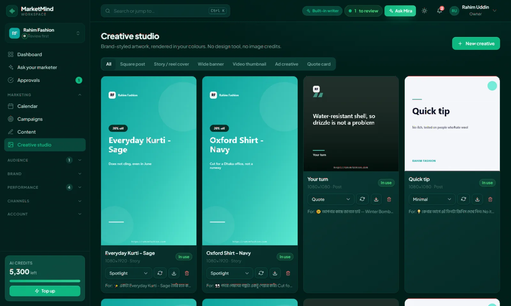
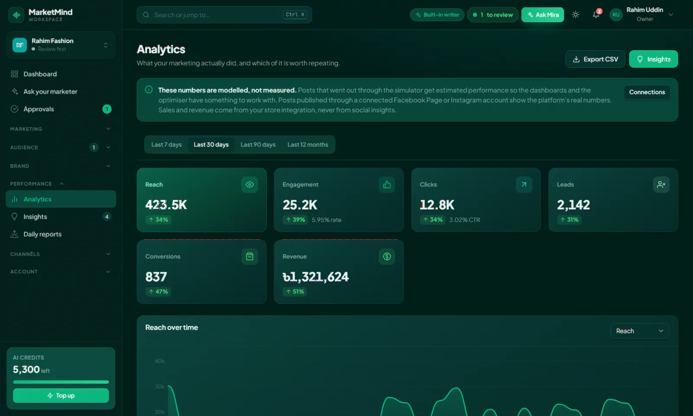
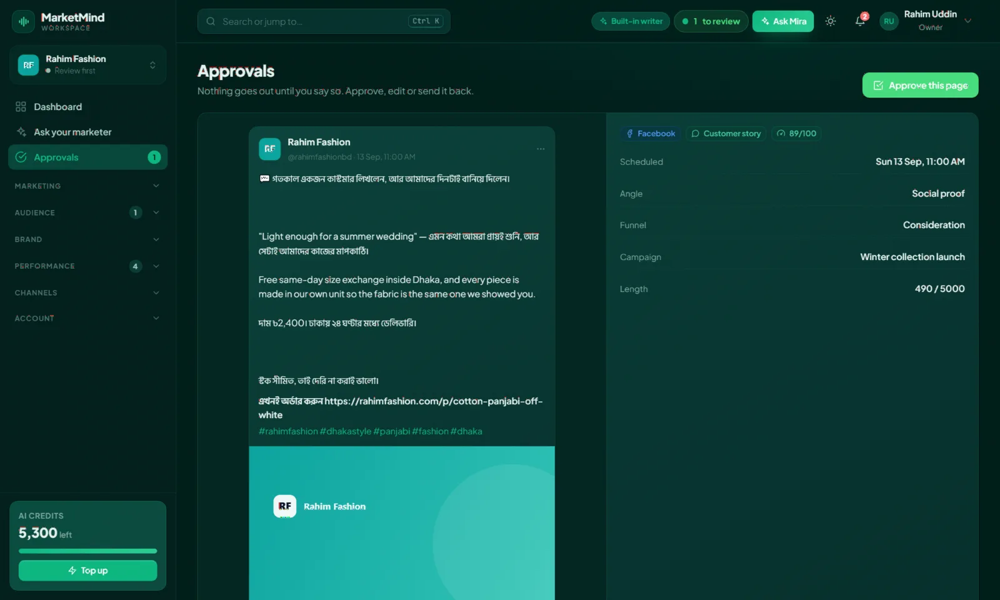

<h3>AI marketing employee that plans, writes and publishes campaigns across channels</h3>

A multi-tenant SaaS platform that works like a marketing hire rather than a content tool. It learns the brand, plans the campaign, writes and designs every post, publishes on schedule across social, email, SMS and WhatsApp, then reads the results and adjusts what it does next.

   

<a href="https://marketmind.skotechlabs.com"><b>Live Demo</b></a> &nbsp;·&nbsp; <a href="https://skotechlabs.com/projects/marketmind-ai-marketing-employee"><b>Case Study</b></a> &nbsp;·&nbsp; <a href="https://skotechlabs.com/contact"><b>Request a Demo</b></a> &nbsp;·&nbsp; <a href="https://github.com/skotechlabs"><b>All Products</b></a>

---

## Overview

MarketMind is an AI marketing employee for small and growing businesses — not another content generator. It is given a brand brief once, and from then on it plans the campaign, writes every post in Bangla or English, designs the creative, publishes on schedule to every connected channel, reads the numbers back and changes what it does next.

The product is built around one idea: the AI is only as good as what it knows about the business. A brand brief, a product catalogue and a list of live offers feed a single briefing that every agent reads before it writes a word. The offers table doubles as a guard rail — the AI may only promise a discount that is actually listed, so it cannot invent one.

Facebook Pages and Instagram Business accounts connect with one click through Facebook Login. Posts go out with their artwork, and the reach and engagement come straight back from Meta into the reports. Numbers from a real account are kept strictly apart from estimates, and the dashboard says which is which.

Everything a workspace touches is a row an administrator can edit: channels, content types, campaign objectives, tone presets, creative templates, message templates, pricing plans, credit packs and the system prompt of every agent. Before a new AI model reaches customers, the admin can run it against a real brand and read its Bangla and English copy side by side with the built-in writer.

Each workspace can carry several brands, invite a team with owner, manager and editor roles, and choose how much the AI is allowed to do on its own — from reviewing every post before it goes out, to full autopilot.

<table>
<tr>
<td width="50%" valign="top">

### The Challenge

A small business that cannot afford a marketing team ends up with no marketing at all, or with a freelancer who writes captions but does not plan, schedule, measure or adjust. Generic AI writing tools do not fix that: they produce text with no knowledge of the brand, no calendar behind it, no approval step, and no idea whether the last post worked.

</td>
<td width="50%" valign="top">

### Our Solution

We built the whole marketing workflow as one product. A brand brief, product catalogue and live-offer list feed a single briefing that every AI agent reads before writing. From there the strategy agent plans the campaign, the content agent fills the calendar and writes in Bangla or English, the creative studio renders brand-coloured artwork, the publisher posts it to Facebook Pages and Instagram through Facebook Login at the best time, and live insights from Meta feed back into the next plan. A three-level approval workflow decides how much of that runs without a human.

</td>
</tr>
</table>

## Key Features

- Brand brief the AI actually writes from
- AI strategy and campaign planning
- Automatic content calendar
- Bangla and English copywriting
- Brand-styled creatives, no design tool
- Connect Facebook & Instagram with one click
- Multi-channel publishing and scheduling
- Real post insights from Meta
- Customer segmentation
- Email, SMS and WhatsApp broadcasts
- Competitor monitoring
- Three-level approval workflow
- AI test run before a model goes live
- Multi-brand workspaces and team roles

## Business Impact

- One brand brief drives the strategy, the copy, the creative and the schedule
- Writes and publishes in both Bangla and English, with Bangla artwork that renders correctly
- Facebook Pages and Instagram accounts connect through Facebook Login - no passwords, no pasted tokens
- Real reach and engagement from Meta, never mixed with estimated numbers
- Nothing reaches a customer without approval while approval mode is on
- Every channel, plan, price, template and agent prompt is editable from the admin panel

## Screenshots

<table>
<tr>
<td width="50%" valign="top"> Platform admin - workspaces, credits, output and margin in one view</td>
<td width="50%" valign="top"> Connections - Facebook Pages and Instagram accounts link with one Facebook sign-in</td>
</tr>
<tr>
<td width="50%" valign="top"> The content calendar the AI fills and keeps topped up</td>
<td width="50%" valign="top"> Creative studio - artwork rendered in the brand colours, no design tool</td>
</tr>
<tr>
<td width="50%" valign="top"> Analytics - real numbers from connected accounts, and a clear label on anything estimated</td>
<td width="50%" valign="top"> Approvals - nothing publishes until a human says yes</td>
</tr>
</table>

> See it running: **[marketmind.skotechlabs.com](https://marketmind.skotechlabs.com)**

## Technology Stack

## Source Code & Licensing

This repository is the public showcase for **MarketMind**. The production source code is proprietary and is maintained privately by SKO TechLabs.

Interested in this product for your business? We offer:

- **Ready-to-launch deployment** of MarketMind under your own brand and domain
- **Customisation** of features, workflows, languages and integrations to fit how you work
- **Custom development** of a new product built on the same foundations
- **Ongoing support**, hosting, maintenance and feature roll-outs after launch

## Get in Touch

---

© 2026 <a href="https://skotechlabs.com">SKO TechLabs</a> · Dhaka, Bangladesh · Building intelligent digital solutions

